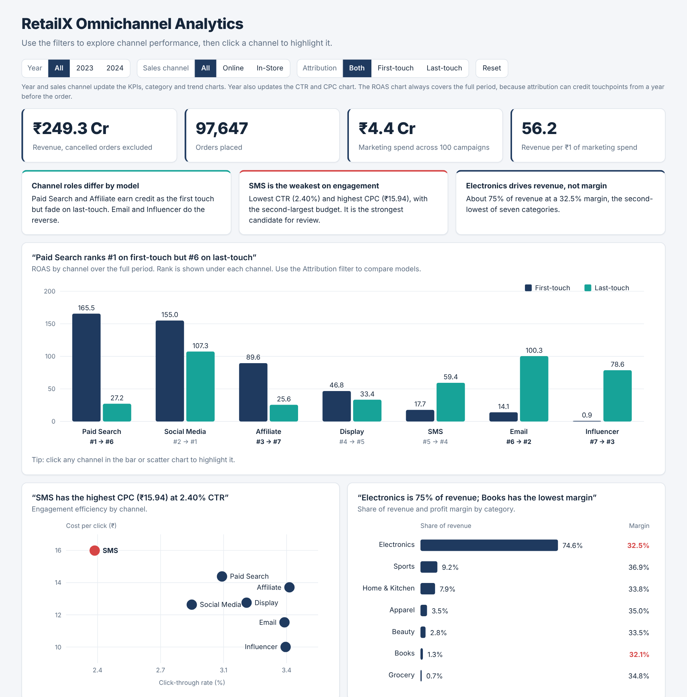

# RetailX Omnichannel Analytics
 
A SQL Server analysis of a simulated omnichannel retailer, built to find out which marketing channels, product categories and customer segments actually drive revenue and profit. It includes a documented data quality audit and an interactive dashboard of the results.
 
**Stack:** SQL Server (T-SQL) | Window functions, CTEs | Cohort, RFM and attribution analysis | Interactive dashboard (HTML/JS prototype)
 
---
 
## Live Dashboard
 
[](https://chhaviikakkar.github.io/RetailX-Omnichannel-Analytics/)
 
**[Open the interactive dashboard](https://chhaviikakkar.github.io/RetailX-Omnichannel-Analytics/)**
 
- **Filters:** year, sales channel and attribution model (first-touch or last-touch). Click any channel to highlight it across charts.
- **Charts:** ROAS by channel under both attribution models, CTR vs CPC, category share and margin, spend vs ROAS, rank change between models, cohort retention heatmap, monthly revenue.
- **Note on filters:** the ROAS chart always covers the full period. First-touch credit can go to a touchpoint from the year before the order, so filtering it by year gives misleading numbers.
- **How it was made:** the dashboard is a static prototype built from the aggregated outputs of the SQL queries in this repo. It is not connected to a live database. It was built with AI assistance; the analysis, queries and findings are my own.
### At a glance (cancelled orders excluded)
 
| Revenue | Orders | Marketing spend | Overall ROAS |
|---|---|---|---|
| ₹249.3 Cr | 97,647 | ₹4.4 Cr | 56.2 |
 
---
 
## The Business Problem
 
RetailX is a mid-size omnichannel retailer (online and physical stores). It wants to know how marketing spend across seven channels (Email, Social Media, Paid Search, Display, Affiliate, SMS, Influencer) translates into sales, and where customers are acquired, retained or lost. This project analyses two years of customer, sales and marketing data to answer that.
 
**Scope:** this is an EDA-first project, not a data engineering one. There are no ETL layers or bronze/silver/gold architecture. Data quality issues are identified, quantified and documented rather than corrected upstream, and the data is analysed as it is.
 
## Key Findings
 
Full write-up with supporting numbers in [`findings.md`](findings.md). Headlines:
 
- **Channel rankings change sharply with the attribution model.** Paid Search ranks #1 on first-touch (ROAS 165.5) but #6 on last-touch (27.2). Email and Influencer move the other way (#6 to #2 and #7 to #3). One model alone is not enough for a budget decision, because channels play different roles: some introduce customers, others close the sale.
- **Electronics drives about 75% of revenue** almost entirely on price, not volume, and has one of the lowest margins (32.5%). The highest-revenue category and the highest-margin category are different.
- **SMS is the weakest channel** on engagement (lowest CTR at 2.40%, highest CPC at ₹15.94) and tied for the highest overspend rate (4 of 21 campaigns).
- **Acquisition labels are an unreliable stand-in for attribution.** 40% of customers are Organic or Direct and cannot match a paid channel by construction, so they are excluded. Among the 17,952 paid-acquired customers, 85% were touched by their credited channel at some point, but only 58.5% were touched by it on or before the acquisition date. About 4 in 10 have no earlier touch from the channel credited with acquiring them.
- **Late-period growth and retention are data artifacts.** Month-1 retention rises from 12% to 76% across cohorts, and revenue spikes in the final months. Both come from how orders were generated, not real business momentum, so they are flagged rather than reported as trends.
## Recommendations
 
1. Re-evaluate SMS budget allocation: it is the weakest on engagement and budget discipline.
2. Do not rely on a single attribution model for budget decisions. Weigh each channel's role (awareness vs conversion).
3. Focus return-cost control on Electronics, where each return is expensive, rather than on reducing return rates, which are similar across categories.
## Approach
 
The analysis runs in four levels, each building on the last.
 
1. **Data quality profiling.** Every table was checked for row counts, date ranges, referential integrity, NULL patterns, categorical consistency and logical impossibilities (for example, can a refund exceed the item it belongs to?). Eight or more real findings came out of this stage, including a refund bug affecting about 34.5% of returns that was traced to its root cause. See [`data_quality_log.md`](data_quality_log.md).
2. **Core KPIs.** Revenue, AOV, CTR, CPC, budget discipline, category and brand margin, and returns, each with an explicit business rule (for example, how Cancelled orders are treated in revenue).
3. **Trends and behaviour.** Product rankings, month-over-month growth, running totals, a session-to-order funnel and repeat-purchase gaps, using `DENSE_RANK`, `LAG` and `SUM() OVER()`.
4. **Advanced analysis.** RFM segmentation, channel-diversity value, cohort retention, acquisition-label accuracy, and first-touch and last-touch attribution with ROAS by channel.
## Dataset
 
A synthetic, relationally consistent dataset that simulates a retailer's data warehouse.
 
| Table | Rows | Table | Rows |
|---|---|---|---|
| customers | 30,000 | marketing_touchpoints | 520,000 |
| orders | 105,000 | sessions | 210,000 |
| order_items | 213,931 | marketing_spend | 9,949 |
| campaigns | 100 | products | 150 |
| returns | 19,971 | stores | 40 |
 
The window runs from 2023-01-01 to 2024-12-30. IDs follow one format per entity across all tables (`CAMP001`, `CUS00001`, `PROD001`, and so on).
 
## Data Quality: What Was Found and How It Was Handled
 
Data quality is treated as part of the analysis, not a step to skip past. Details are in [`data_quality_log.md`](data_quality_log.md).
 
- Referential integrity was verified across five key relationships using count comparisons, with zero orphans.
- A refund calculation issue affecting about 34.5% of returns at item level was traced to pre-discount vs post-discount values, rather than only flagging the symptom.
- A right-censoring issue affecting returns near the dataset's end date was identified and explained.
- Judgment calls are documented. For example, 47 customers with pre-window acquisition dates were flagged and retained rather than deleted, with the reasoning stated.
## Notable Technical Challenges
 
These bugs were caught and fixed during the project. They are left visible in the SQL comments because the debugging process is worth showing.
 
- **Join fan-out:** several queries first joined transactional tables (`order_items`, `returns`, `marketing_touchpoints`) on a partial key, such as `order_id` alone instead of `order_id` and `product_id`. This silently multiplied rows and inflated aggregates until sanity checks against known totals caught it.
- **Window function partitioning:** an early overspend query used `SUM() OVER (ORDER BY campaign_id)` with no `PARTITION BY`, giving a running total across all campaigns instead of each campaign's own total.
- **`LEFT JOIN` + `WHERE`:** filtering on a right-hand column after a `LEFT JOIN` behaves like an `INNER JOIN` and drops the rows the `LEFT JOIN` was meant to keep. This came up in the funnel, channel-value and attribution queries, and was fixed by moving the condition into `ON`.
## Limitations
 
- CPA (cost per acquisition) by channel was scoped but not completed.
- Attribution uses only first-touch and last-touch, with no credit for touchpoints in between. It also counts every touchpoint type, including impressions. A separate check using only clicks and engagements keeps the introducer vs closer pattern (Paid Search falls from #2 to #6, Email and Influencer rise), but Social Media then ranks #1 on both models. The "ranking changes" conclusion holds; "the best channel flips completely" depends on what counts as a touch.
- Growth and retention in the dataset's final months are inflated by order-date generation, as described in `findings.md`.
- This project deliberately did not pursue heavy cleaning or ETL.
- The dashboard is a static prototype. A native Tableau or Power BI version is planned.
## Repository Structure
 
```
RetailX-Omnichannel-Analytics/
├── README.md                       <- you are here
├── findings.md                     <- business insights from all four levels
├── data_quality_log.md             <- full data quality audit
├── 00_db_setup.sql                 <- database, schema, tables, data load
├── 01_data_profiling.sql           <- Level 1: data quality checks
├── 02_core_kpi.sql                 <- Level 2: revenue, CTR/CPC, overspend, margin, returns
├── 03_trends_and_behaviour.sql     <- Level 3: rankings, growth, running totals, funnel
├── 04_advanced_analytics.sql       <- Level 4: RFM, cohorts, attribution, ROAS
├── data/                           <- source CSVs
├── docs/index.html                 <- interactive dashboard (GitHub Pages)
└── images/dashboard.png            <- dashboard screenshot
```
 
**Suggested reading order:** this README, then `findings.md`, then `data_quality_log.md`, then the SQL files in numeric order.
 
## How to Reproduce
 
1. Extract the CSVs from the `data` folder to a local path.
2. Open `00_db_setup.sql`, update the `BULK INSERT` file paths to match, and run the whole script. It creates the database, schema and all 10 tables, and loads the data.
3. Run `01_data_profiling.sql` through `04_advanced_analytics.sql` in order. Each query is commented with its business question, the query itself and the finding it produced.
---
 
Built as a portfolio project to demonstrate SQL analysis, data quality auditing and business-focused EDA.
 
**Chhavi Kakkar** | [LinkedIn](https://linkedin.com/in/chhavi-kakkar) | [GitHub](https://github.com/chhaviikakkar) | chhaviikakkar@gmail.com
 
